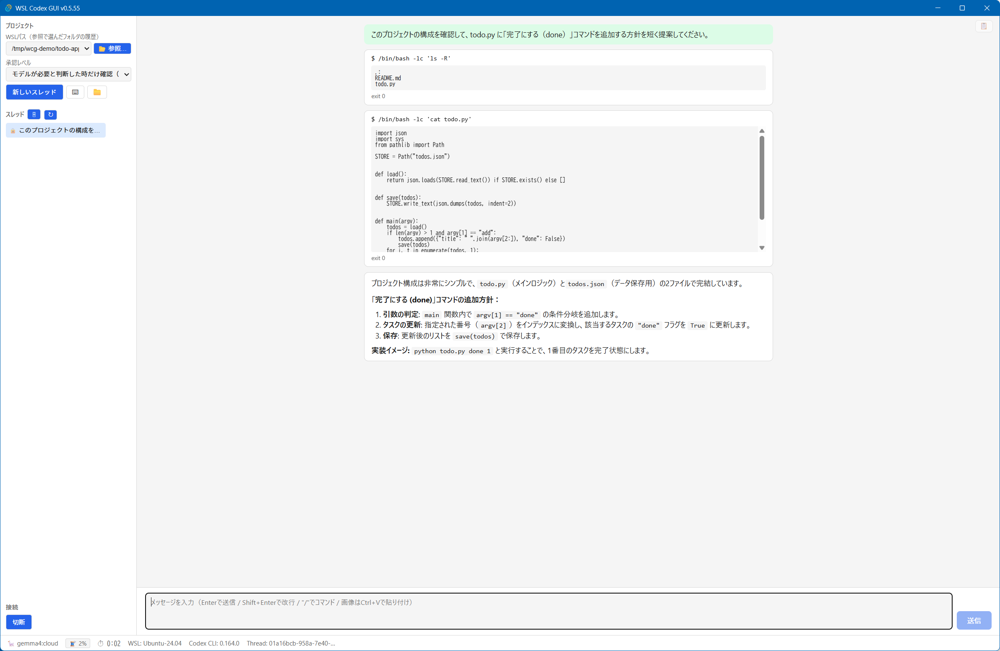
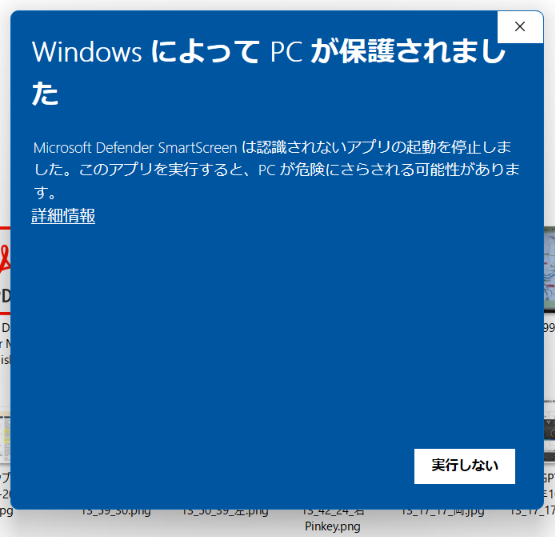

# WSL Codex GUI

[Codex CLI](https://github.com/openai/codex) を、WindowsのデスクトップアプリとしてGUIで使うためのツールです。
WSL2の中に入れたCodex CLI（またはWindowsに直接入れたCodex CLI）を、チャット画面から操作できます。

> **これはOpenAIの公式製品ではありません。** 個人が開発した非公式のツールで、OpenAIとは関係ありません。



## できること

- **チャットでCodexに作業を頼む**: 応答はMarkdownで整形表示。実行中の推論の経過も表示します
- **スレッドの管理**: 一覧・再開・名前変更・アーカイブ
- **承認ダイアログ**: Codexがコマンド実行やファイル変更の許可を求めたら、その場で選べます
- **モデル・推論レベル・速度の切り替え**: 接続後もフッターからいつでも変更できます
- **使用量の表示**: プランの残り（%）をフッターに常時表示
- **画像の貼り付け・ファイルのドラッグ&ドロップ**: WSLモードではWindowsのパスをWSLのパスに自動変換
- **Ollama対応**: ローカル（またはOllama Cloud）のモデルでもCodexを動かせます
- **離席中の完了通知**: 操作していない間にターンが終わると、タスクバーで知らせます
- **日本語入力（IME）対応**: 変換確定のEnterで誤送信しません

## 動作環境

| 項目 | 内容 |
|---|---|
| OS | Windows 10 / 11（x64） |
| WebView2 Runtime | Windows 11は標準搭載。Windows 10では別途インストールが必要な場合があります |
| Codex CLI | **別途インストールが必要です**（このアプリには含まれません。下記参照） |

接続方式は2種類から選べます。

- **WSLモード**（既定）: WSL2の中に入れたCodex CLIを使います。設定・認証・プロジェクトファイルはすべてWSL側に置きます
- **Windows-nativeモード**: Windowsに直接入れたCodex CLIを使います。WSLは不要です

どちらの方式でも、アプリとCodex CLIは標準入出力で直接つながり、ネットワークポートは使いません。

Ollamaを使う場合は、Windows側にOllama CLIをインストールしてください。Ollamaを選ぶと、ローカルAPIが停止している場合にアプリが`ollama serve`を起動し、モデル一覧を取得します。Ollamaのモデルは別途取得が必要です。

## インストール

### 1. Codex CLIを入れる

**WSLモードで使う場合**は、WSLのターミナル（Windows側のシェルではなく）で次を実行します。

```bash
npm install -g @openai/codex@latest
codex --version
which codex    # 表示された絶対パスを控えておく
```

Windows側でインストールしたCodex CLIは、WSLの中では動きません。必ずWSLのターミナルから入れてください。

**Windows-nativeモードで使う場合**は、PowerShellで次を実行します。

```powershell
npm install -g @openai/codex@latest
```

どちらの場合も、`codex`を一度起動してサインイン（ChatGPTアカウントまたはAPIキー）を済ませておいてください。

### 2. アプリを入れる

[Releases](https://github.com/FuyukiYoneyama/WslCodexGui/releases) から、NSISインストーラ（`WslCodexGui_<バージョン>_x64-setup.exe`）をダウンロードして実行します。

> **公開中の0.5.64インストーラは未署名です。** 0.5.62をGitHub Releaseからブラウザで取得した試験では、Edgeの「一般的にダウンロードされていません」と、起動時のWindows SmartScreen「WindowsによってPCが保護されました」を確認しました。警告が出ることを前提にダウンロードしてください。
> 続行する場合は、配布元とReleasesに載せているSHA-256を確認してから、ご自身の判断で「詳細情報」→「実行」を選んでください。
>
> ```powershell
> Get-FileHash .\WslCodexGui_<バージョン>_x64-setup.exe
> ```



旧版から更新する場合も、警告画面の後にインストーラーを起動します。インストーラーが起動した後は、旧版のアンインストール画面を経ずに上書き更新します。

### 3. 初回の接続

アプリを起動すると、接続の設定画面が出ます。

1. **プロバイダ**: OpenAI（既定）またはOllama
2. **接続方式**: WSL内のCodex CLI（既定）またはWindows側のCodex CLI
   - WSLの場合は、WSLのディストリ名とCodex CLIの絶対パスを選びます（多くの場合、自動で見つかります）
3. 「接続」を押します

接続できたら、プロジェクトのフォルダを選び、「新しいスレッド」でチャットを始めます。設定は保存されるので、次回からは入力不要です。

## 対応しているCodex CLIのバージョン

Codex CLIは頻繁に更新されます。このアプリで動作を確認したバージョンは [app/src/codexVersion.ts](app/src/codexVersion.ts) の `CONFIRMED_CODEX_CLI_VERSIONS` に記録しています。確認済みでないバージョンでも多くの場合は動きますが、接続時に「新しいCodex CLIバージョンです」という注意を表示します（同じバージョンでは次回から表示しません）。

## 既知の制限

- Windows専用です（macOS・Linux版はありません）
- インストーラは未署名です（上記のSmartScreenの警告）
- Codex CLIの仕様変更により、新しいバージョンで一部の機能が動かなくなることがあります
- Ollamaでは、モデルによってツール呼び出し（コマンド実行など）がうまく動かないことがあります。これはモデルやOllama側の対応状況によるものです

## ソースからビルドする

開発環境の準備・ビルド方法・トラブルシューティングは [app/README.md](app/README.md) を参照してください。設計の背景と検証記録は [docs/仕様書.md](docs/仕様書.md) にあります。

## ライセンス

[MIT License](LICENSE) で配布しています。

このアプリが含むサードパーティのソフトウェアのライセンスは [THIRD-PARTY-LICENSES.txt](THIRD-PARTY-LICENSES.txt) にまとめています（インストーラにも同梱しています）。

## フィードバック

不具合の報告や要望は [Issues](https://github.com/FuyukiYoneyama/WslCodexGui/issues) へお願いします。
